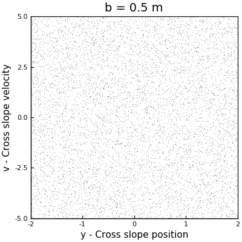

# Moguls of Chaos

What are the moguls and why are they related to chaos? Mogul skiing is a ski discipline that consists of descending a slope full of small regular bumps. Ed Lorenz noticed that objects descending the moguls exhibit chaotic behavior. He built a toy numerical model to explore the dynamics of an idealized board descending such type of slopes and exemplified some of the tools used for characterizing chaos. This was published in his book *The Essence of Chaos*.

This project aims to implement this toy-model experiment that model.

**Update:** I created this project seven years ago. I still find it interesting and I wanted to use it as a project to reinforce my Pytorch skills. The idea is to train a NN with the sleds trajectories that exhibit chaos and recreate the Poincaré sections from a data-driven model.

## Structure

### Part 1 : Solving the dynamics

I put the explanation and the results (code-free) in a blog post that you can find here: [Part 1. Moguls of Chaos](https://cpierard.github.io/projects/moguls-of-chaos/). 

**Warning!** The results showed in the blogpost were created from two jupyter notebooks, found in  `notebooks\`, 7 years ago!. I recommend reading the blog post to understand how to build the sleds toy-model. I don't recomend running the notebooks, because I didn't save the python or julia environemts used to code them, therefore, they might not run.

### Part 2 : Trainning the neural network on the solved trajectories

I wrote a blog post about this section that can be found here: [Part 2. Moguls of Chaos with deep learning](https://cpierard.github.io/projects/neural-moguls/).

This is a description on how to used this scripts and I recomend executing them on the order I'm mentioning.

1. The python environment parameters are saved in `environmet.yml` and should be used to create a conda environment for this project.
2. In `generate_trajectories.py` I solve the trajectories of the sleds and save them in zarr files. The zarr contain the data to train the neural network.
3. `prepare_data.py` defines two functions used to load and split the dataset into training, testing and validation subsets.
4. `train_mlp` Is the script where I train the network or multilayer perceptron. Also, the validation and testing happens in this script. All part 2 figures shown in the blog post are made here.

## References

- Lorenz, Edward N. *The Essence of Chaos*. Univ. of Washington Press, 1993.
